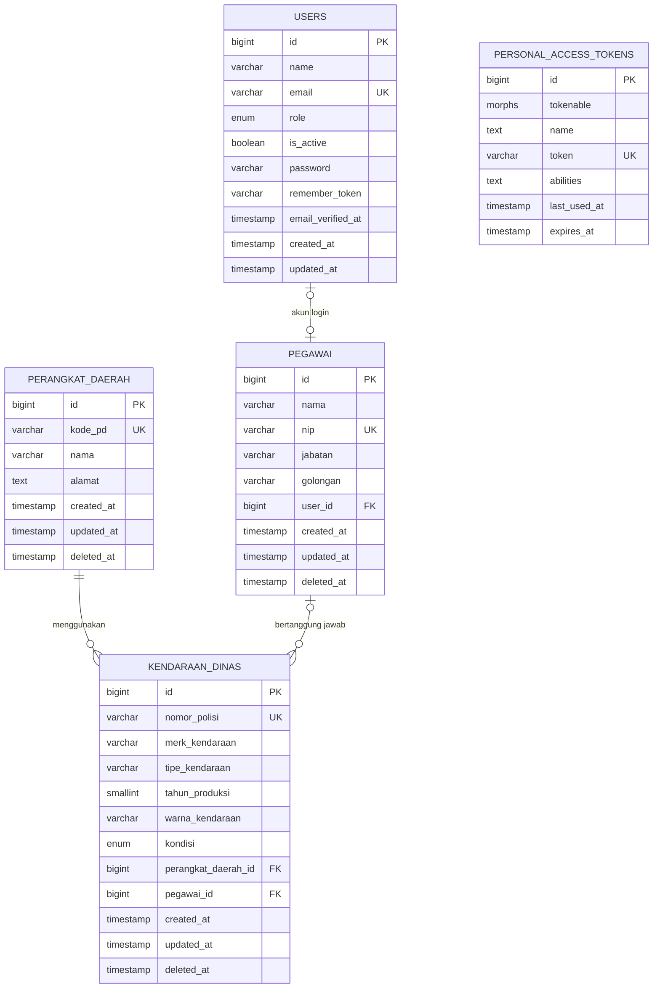

# Skema Database db_kdo

- DBMS: MySQL 8.0, engine InnoDB, collation utf8mb4_unicode_ci
- Nama database: `db_kdo`
- Dump lengkap (struktur dan data): [database/dump/db_kdo_full.sql](../../database/dump/db_kdo_full.sql)
- Dump struktur saja: [database/dump/db_kdo_schema_only.sql](../../database/dump/db_kdo_schema_only.sql)

## Diagram relasi



Tabel `personal_access_tokens` tidak punya foreign key ke tabel KDO. Hubungannya ke user lewat kolom `tokenable`, yang diatur oleh Sanctum.

## Tabel

### perangkat_daerah

Instansi yang memakai kendaraan dinas.

| Kolom | Tipe | Null | Keterangan |
|---|---|---|---|
| id | bigint unsigned | tidak | Primary key, auto increment |
| kode_pd | varchar(20) | tidak | Kode instansi |
| nama | varchar(255) | tidak | Nama instansi |
| alamat | text | ya | Alamat instansi |
| created_at, updated_at | timestamp | ya | |
| deleted_at | timestamp | ya | Soft delete |

Index:
- `PRIMARY (id)`
- `UNIQUE perangkat_daerah_kode_pd_aktif_unique (kode_pd_aktif)`

`kode_pd_aktif` adalah kolom generated dengan rumus `IF(deleted_at IS NULL, kode_pd, NULL)`. Kode yang unik hanya dicek untuk data yang belum dihapus.

### pegawai

Pegawai yang bisa menjadi penanggung jawab kendaraan dinas.

| Kolom | Tipe | Null | Keterangan |
|---|---|---|---|
| id | bigint unsigned | tidak | Primary key, auto increment |
| nama | varchar(255) | tidak | Nama lengkap |
| nip | varchar(30) | tidak | Nomor Induk Pegawai |
| jabatan | varchar(255) | tidak | Jabatan |
| golongan | varchar(20) | tidak | Golongan, contoh `III/a` |
| user_id | bigint unsigned | ya | Akun login pegawai, berelasi ke `users.id`. Satu pegawai paling banyak satu akun |
| created_at, updated_at | timestamp | ya | |
| deleted_at | timestamp | ya | Soft delete |

Index:
- `PRIMARY (id)`
- `UNIQUE pegawai_nip_aktif_unique (nip_aktif)`
- `UNIQUE pegawai_user_id_unique (user_id)`

Foreign key: `user_id` ke `users.id` dengan `ON DELETE SET NULL`.

`nip_aktif` adalah kolom generated dengan rumus `IF(deleted_at IS NULL, nip, NULL)`.

### kendaraan_dinas

Data kendaraan dinas operasional.

| Kolom | Tipe | Null | Default | Keterangan |
|---|---|---|---|---|
| id | bigint unsigned | tidak | auto | Primary key |
| nomor_polisi | varchar(20) | tidak | | Disimpan huruf besar dengan spasi tunggal |
| merk_kendaraan | varchar(100) | tidak | | Merk |
| tipe_kendaraan | varchar(100) | ya | | Tipe atau model |
| tahun_produksi | smallint unsigned | tidak | | Tahun produksi |
| warna_kendaraan | varchar(50) | tidak | | Warna |
| kondisi | enum | tidak | `baik` | `baik`, `rusak_ringan`, `rusak_berat` |
| perangkat_daerah_id | bigint unsigned | ya | | Berelasi ke `perangkat_daerah.id` |
| pegawai_id | bigint unsigned | ya | | Penanggung jawab, berelasi ke `pegawai.id` |
| created_at, updated_at | timestamp | ya | | |
| deleted_at | timestamp | ya | | Soft delete |

Index:
- `PRIMARY (id)`
- `UNIQUE kendaraan_dinas_nomor_polisi_aktif_unique (nomor_polisi_aktif)`. Kolom generated `nomor_polisi_aktif` berisi `IF(deleted_at IS NULL, nomor_polisi, NULL)`.
- `INDEX kendaraan_dinas_perangkat_daerah_id_foreign (perangkat_daerah_id)`
- `INDEX kendaraan_dinas_pegawai_id_foreign (pegawai_id)`

Foreign key:

| Kolom | Referensi | ON DELETE |
|---|---|---|
| perangkat_daerah_id | perangkat_daerah.id | SET NULL |
| pegawai_id | pegawai.id | SET NULL |

### users

| Kolom | Tipe | Keterangan |
|---|---|---|
| id | bigint unsigned | Primary key |
| name | varchar(255) | |
| email | varchar(255) | Unik |
| role | enum(`admin`, `operator`) | Default `operator`. Hanya admin yang bisa membuat akun pegawai dan mengelola pengguna |
| is_active | boolean | Default `true`. Akun nonaktif tidak bisa login |
| email_verified_at | timestamp | Boleh kosong |
| password | varchar(255) | Hash bcrypt |
| remember_token | varchar(100) | Boleh kosong |
| created_at, updated_at | timestamp | |

### Tabel bawaan framework

- `personal_access_tokens`: token Sanctum. Kolomnya `tokenable_type`, `tokenable_id`, `token` (unik), `abilities`, `last_used_at`, dan `expires_at`.
- `password_reset_tokens`, `sessions`, `cache`, `cache_locks`, `jobs`, `job_batches`, `failed_jobs`: dibuat oleh Laravel.
- `migrations`: riwayat migrasi yang sudah dijalankan.

## Migrasi

| Batch | File | Isi |
|---|---|---|
| 1 | 0001_01_01_000000_create_users_table | users, password_reset_tokens, sessions |
| 1 | 0001_01_01_000001_create_cache_table | cache, cache_locks |
| 1 | 0001_01_01_000002_create_jobs_table | jobs, job_batches, failed_jobs |
| 2 | 2026_10_11_000001_create_perangkat_daerah_table | perangkat_daerah |
| 2 | 2026_10_11_000002_create_pegawai_table | pegawai |
| 2 | 2026_10_11_000003_create_kendaraan_dinas_table | kendaraan_dinas. Membutuhkan dua tabel di atas |
| 3 | 2026_11_10_043738_create_personal_access_tokens_table | personal_access_tokens |
| 4 | 2026_11_10_100000_make_unique_indexes_ignore_soft_deleted | Unique `kode_pd`, `nip`, dan `nomor_polisi` diganti ke kolom generated `*_aktif` |
| 5 | 2026_11_10_110000_add_user_id_to_pegawai_table | Menambah `pegawai.user_id` |
| 6 | 2026_11_10_120000_add_role_to_users_table | Menambah `users.role` |
| 7 | 2026_11_10_130000_add_is_active_to_users_table | Menambah `users.is_active` |

Urutan ini penting. `kendaraan_dinas` punya foreign key ke `perangkat_daerah` dan `pegawai`, jadi harus dibuat setelah keduanya.

## Data awal (seeder)

| Seeder | Isi |
|---|---|
| DatabaseSeeder | Akun `test@example.com` (admin) dan `operator@example.com` (operator), keduanya dengan password `password` |
| PerangkatDaerahSeeder | 6 instansi, PD-001 sampai PD-006 |
| PegawaiSeeder | 5 pegawai |
| KendaraanDinasSeeder | 6 kendaraan. Sebagian punya penanggung jawab, sebagian tidak |

Seeder bisa dijalankan ulang tanpa membuat data ganda.

## Dump dan restore

Membuat dump:

```bash
mysqldump -h 127.0.0.1 -u developer --single-transaction --routines --triggers --events \
  --set-gtid-purged=OFF --default-character-set=utf8mb4 \
  db_kdo > database/dump/db_kdo_full.sql
```

Restore ke database baru:

```bash
mysql -h 127.0.0.1 -u developer -e "CREATE DATABASE db_kdo CHARACTER SET utf8mb4 COLLATE utf8mb4_unicode_ci;"
mysql -h 127.0.0.1 -u developer db_kdo < database/dump/db_kdo_full.sql
```

Dump pernah diuji dengan restore ke database lain. Jumlah baris di setiap tabel sama dengan database asli: users 1, perangkat_daerah 6, pegawai 5, kendaraan_dinas 6, migrations 7, dan 13 tabel.

Dump lengkap memuat hash password akun uji. Jika file dibagikan di luar tim, pakai `db_kdo_schema_only.sql` atau hapus data user lebih dulu.

## Catatan

1. **Unique dan data terhapus.** Kolom `nomor_polisi`, `nip`, dan `kode_pd` hanya dicek unik untuk data yang belum dihapus, lewat kolom `*_aktif`. Validasi request juga mengabaikan data yang sudah dihapus. Akibatnya nomor yang pernah dihapus bisa dipakai lagi.
2. **Index untuk filter kondisi.** Endpoint daftar kendaraan memfilter kolom `kondisi`, tapi kolom ini belum di-index. Data masih sedikit, jadi belum terasa. Jika data sudah banyak, tambahkan `INDEX (kondisi)`.
3. **Penanggung jawab.** `pegawai_id` boleh kosong dan memakai `ON DELETE SET NULL`. Menghapus pegawai secara permanen hanya mengosongkan kolom penanggung jawab di kendaraan. Kendaraannya tidak ikut terhapus.
